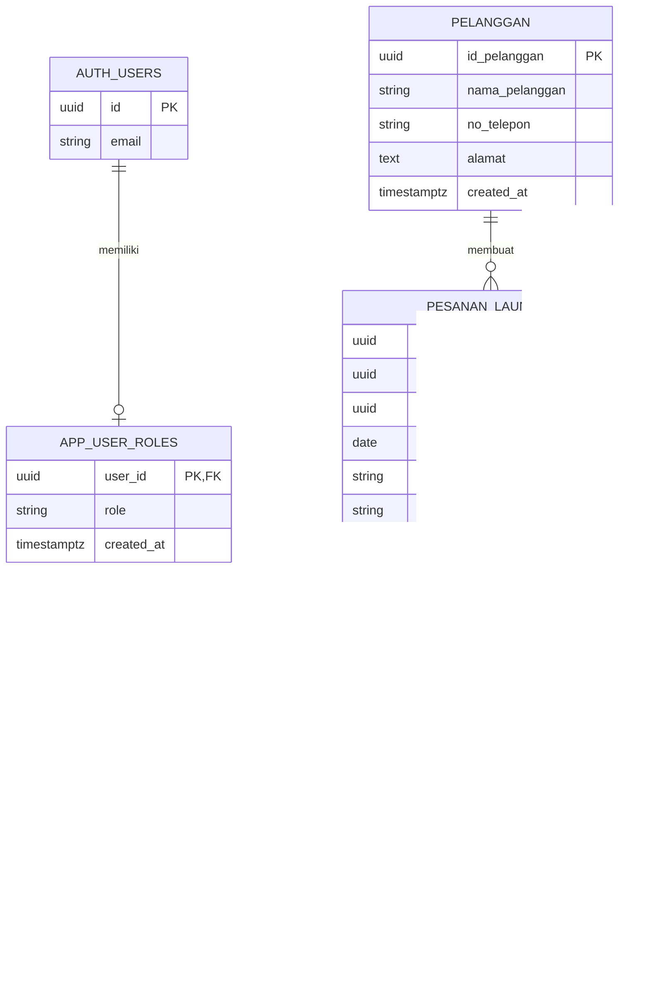

# Bagaskara Laundry

Sistem informasi operasional dan akuntansi sederhana untuk usaha laundry. Aplikasi membantu mencatat pelanggan, pesanan multi-layanan, pembayaran, progres pengerjaan, pengambilan cucian, serta menyajikan ringkasan pendapatan dan laporan akuntansi berbasis penerimaan.

> **Demo web:** [Buka Bagaskara Laundry](https://dxsta.github.io/sistem-akuntansi-laundry/)
>
> Demo di-host secara publik melalui GitHub Pages. Login tetap memerlukan akun Supabase yang memiliki role; pendaftaran pengguna publik dinonaktifkan.

## Identitas penyusun

| Informasi | Keterangan |
|---|---|
| Nama | Desta Bagaskara |
| NIM | 12030124120055 |
| Program Studi | S1 Akuntansi, Universitas Diponegoro |
| Mata Kuliah | Pengkodean dan Pemrogaman |
| Kelas | E |
| Dosen Pengampu | Dr. Totok Dewayanto, S.E., M.Si., Akt. |

**Disusun untuk memenuhi Ujian Tengah Semester Pengkodean dan Pemrogaman.**

## Tentang sistem

Bagaskara Laundry adalah aplikasi web untuk mengelola siklus transaksi laundry dari penerimaan sampai pengambilan. Satu transaksi dapat memuat beberapa jenis layanan, baik kiloan maupun satuan, dan dibayar lunas saat transaksi disimpan. Data aplikasi disimpan di Supabase, sedangkan antarmuka dibuat dengan HTML, CSS, dan JavaScript.

Sistem ini ditujukan untuk membantu pencatatan dan pemantauan, bukan menggantikan seluruh sistem akuntansi usaha. Modul akuntansinya saat ini berfokus pada penerimaan pembayaran dan belum mencatat beban, modal, aset, utang, pajak, atau transaksi nonkas.

## Fitur

### Dashboard
- Ringkasan pendapatan berdasarkan pembayaran yang tercatat.
- Grafik pendapatan yang dapat dilihat menurut hari, bulan, atau tahun.
- Informasi tanggal dan waktu WIB, identitas usaha, serta tampilan responsif untuk ponsel.

### Operasional
- Pendaftaran dan pencarian pelanggan.
- Pembuatan transaksi dengan beberapa layanan kiloan dan/atau satuan.
- Pilihan metode pembayaran Tunai atau QRIS.
- Daftar pesanan dan riwayat pembayaran, termasuk filter metode pembayaran.
- Antrean pengerjaan dengan penandaan selesai per transaksi.
- Halaman Laundry Siap Ambil dengan filter tanggal dan penandaan pengambilan.

### Akuntansi
- Jurnal umum yang diturunkan dari pembayaran.
- Buku besar untuk akun kas tunai, bank QRIS, dan pendapatan jasa.
- Neraca saldo dan laporan laba rugi berdasarkan periode.
- Laporan pendapatan dengan rincian menurut periode.

### Akun dan akses
- Login melalui Supabase Auth.
- Role pemilik dan satu akun kasir bersama.
- Pemilik dapat mengakses menu akuntansi dan pengaturan akun kasir.
- Kasir bersama dibatasi pada menu operasional.
- Tombol logout tersedia dari menu profil di bagian bawah sidebar.

## Logika akuntansi

Saat satu transaksi disimpan, aplikasi membuat satu pembayaran lunas sebesar jumlah seluruh layanan di transaksi tersebut. Pembayaran dicatat satu kali dan menjadi dasar perhitungan pendapatan; nilai pesanan tidak dijumlahkan lagi sebagai pendapatan kedua.

| Kondisi pembayaran | Debit | Kredit |
|---|---|---|
| Dibayar tunai | Kas Tunai | Pendapatan Jasa Laundry |
| Dibayar dengan QRIS | Bank QRIS | Pendapatan Jasa Laundry |

Jurnal, buku besar, neraca saldo, dan laporan laba rugi dibentuk dari data pembayaran yang tersimpan; aplikasi belum memiliki tabel jurnal atau buku besar terpisah. Pendapatan saat ini diakui pada tanggal pembayaran. Beban belum dicatat sehingga laba bersih yang ditampilkan sama dengan pendapatan dikurangi beban tercatat (sementara nol), bukan laba usaha lengkap.

## Bagan akun

| Kode | Nama akun | Kelompok | Saldo normal |
|---|---|---|---|
| 101 | Kas Tunai | Aset | Debit |
| 102 | Bank QRIS | Aset | Debit |
| 401 | Pendapatan Jasa Laundry | Pendapatan | Kredit |

Bagan akun di atas mencerminkan akun yang saat ini digunakan dalam laporan aplikasi. Akun beban, modal, aset lain, kewajiban, pajak, dan penyesuaian belum tersedia.

## ERD



`pesanan_laundry` menyimpan **baris layanan**. Baris layanan yang memiliki `id_transaksi` sama membentuk satu transaksi; satu pembayaran lunas dibuat untuk transaksi dan ditautkan ke baris layanan pertama. Relasi tersebut menggambarkan implementasi saat ini—skema belum memiliki tabel transaksi induk khusus.

## Struktur folder

```text
.
├── index.html                         # Pengarah GitHub Pages ke aplikasi
├── README.md
├── .gitignore
├── backend/
│   └── database.sql                   # Skema, indeks, RLS, RPC, dan view Supabase
├── frontend/
│   ├── Assets/
│   │   ├── bagaskara-laundry-logo.svg
│   │   └── laundry-shop.jpg           # Foto ilustrasi dashboard
│   ├── CSS/
│   │   └── style.css
│   ├── HTML/
│   │   └── index.html                 # Halaman aplikasi
│   └── JS/
│       ├── app.js
│       └── config.js                  # URL dan publishable/anon key Supabase
└── supabase/
    ├── config.toml
    └── functions/
        └── manage-cashier/
            └── index.ts               # Edge Function pengelolaan akun kasir
```

## Teknologi

- HTML, CSS, dan JavaScript tanpa framework frontend.
- Supabase PostgreSQL, Supabase Auth, Row Level Security (RLS), dan RPC.
- Supabase Edge Function untuk pengelolaan akun kasir.
- GitHub Pages untuk demo frontend statis.

## Cara menjalankan lokal

### Prasyarat

- Project Supabase.
- Browser modern.
- Server web lokal, misalnya Live Server di Visual Studio Code.
- Supabase CLI hanya diperlukan untuk deployment Edge Function melalui terminal.

### Konfigurasi dan database

1. Buat project Supabase dan buat pengguna Auth pemilik melalui **Authentication > Users**. Atur kata sandi secara privat di dashboard, bukan di README, kode, atau query.
2. Buat backup database terlebih dahulu jika project sudah berisi data.
3. Jalankan isi `backend/database.sql` melalui **SQL Editor**. Skrip ini membuat/menyelaraskan skema dan kebijakan RLS; skrip bukan backup data.
4. Berikan role `owner` kepada pengguna pemilik. Jalankan sekali di SQL Editor:

   ```sql
   insert into public.app_user_roles (user_id, role)
   select id, 'owner'
   from auth.users
   where lower(email) = 'desta@laundry.com'
   on conflict (user_id) do nothing;
   ```

   Pastikan hasilnya tercatat sebagai `owner` sebelum login. Jika menggunakan project atau akun berbeda, sesuaikan alamat email pada query.

5. Salin **Project URL** dan **publishable key** (atau anon key) dari pengaturan/API Supabase ke `frontend/JS/config.js`. Publishable/anon key memang digunakan oleh frontend bersama RLS; **jangan pernah** menaruh `service_role` key di frontend atau repository.
6. Matikan pendaftaran publik setelah akun yang diperlukan dibuat. Role tidak diambil dari metadata pengguna, melainkan dari `app_user_roles`.

### Edge Function akun kasir

Deploy fungsi `manage-cashier` melalui Supabase CLI atau editor Edge Functions di Supabase Dashboard. Fungsi membutuhkan `SUPABASE_URL` dan `SUPABASE_SERVICE_ROLE_KEY` sebagai secrets/environment Supabase. Matikan **Verify JWT with legacy secret** untuk fungsi ini; fungsi memeriksa access token melalui Supabase Auth dan hanya melayani pemilik. Jangan letakkan service-role key di file konfigurasi frontend.

### Jalankan aplikasi

1. Buka folder proyek di Visual Studio Code.
2. Jalankan `frontend/HTML/index.html` menggunakan Live Server atau server HTTP lokal. Hindari membuka langsung sebagai `file://` bila browser membatasi permintaan jaringan.
3. Masuk dengan akun Supabase yang telah diberi role.
4. Pemilik dapat membuat atau mengatur kata sandi akun kasir melalui **Pengaturan > Akun Pegawai**. Gunakan kata sandi kuat dan jangan menaruhnya di source code.
5. Buat transaksi melalui **Operasional > Pesanan Laundry**, pilih pelanggan, tambahkan layanan, dan pilih metode Tunai atau QRIS.

## Deployment demo

Demo publik menggunakan GitHub Pages di [https://dxsta.github.io/sistem-akuntansi-laundry/](https://dxsta.github.io/sistem-akuntansi-laundry/). File `index.html` di root repository mengarahkan pengunjung ke halaman aplikasi di `frontend/HTML/`.

Untuk mengaktifkan atau memeriksa deployment: buka repository GitHub **Settings > Pages**, pilih **Deploy from a branch**, branch `main`, folder `/ (root)`, lalu simpan. Setelah workflow Pages selesai, buka URL demo di atas. Aplikasi tetap memerlukan koneksi Supabase yang telah dikonfigurasi dan login yang valid.

## Catatan penting

- Repository dan demo bersifat publik. Jangan menyimpan kata sandi, token, service-role key, data pelanggan, atau cadangan database di repository.
- File konfigurasi frontend berisi Project URL dan publishable/anon key. Key tersebut bukan pengganti RLS; pastikan policies aktif dan akses `anon` tidak dibuka.
- `backend/database.sql` adalah sumber skema tunggal, **bukan dump atau cadangan data**. Simpan backup terpisah sebelum perubahan database yang berisiko.
- Saat menerapkan ulang SQL pada database berisi data, periksa isi skrip dan kebijakan RLS terlebih dahulu. Skrip dapat mengubah kebijakan serta menghapus kolom status pengerjaan lama; setelah dijalankan, pastikan akun pemilik memiliki role agar tidak terkunci dari aplikasi.
- Semua layanan dalam satu transaksi disimpan sebagai beberapa baris pesanan. Jumlah dan harga per unit saat ini menggunakan kolom kompatibilitas `berat_kg` dan `harga_per_kg`; kolom `satuan` membedakan `kg` dan `item`, sedangkan `total_tagihan` dihitung sebagai kolom generated.
- Penerimaan harus lunas pada saat transaksi disimpan. Aplikasi belum mencatat cicilan atau piutang.
- Pendapatan diakui berdasarkan tanggal pembayaran. Beban dan transaksi nonkas belum dicatat, sehingga laporan laba rugi belum mewakili seluruh kondisi keuangan usaha.
- Akun kasir adalah akun bersama. Aktivitas tidak dapat ditelusuri ke pegawai individual.
- Dashboard menggunakan foto ilustrasi laundry, bukan foto lokasi toko. Atribusi foto dan tautan lisensi ditampilkan di aplikasi.
